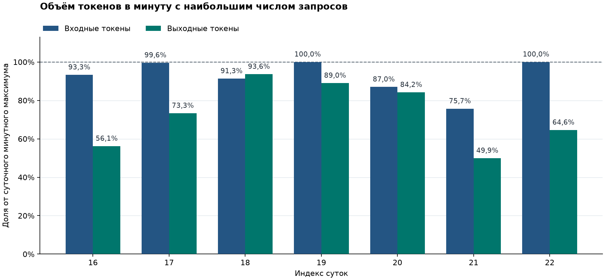

# Economics-analysis

## Этап 2. Симуляция на Llama 3 8B и A100 80 ГБ

В симуляции Vidur за сутки 16 одной GPU хватило и для исходного, и для равномерного потока. В каждом прогоне 100% запросов получили первый токен за 2 секунды или быстрее. Вторая GPU снизила P95 задержки первого токена в исходном потоке с 0,283 до 0,262 с. [Результаты четырёх прогонов и конфигурация](stage2/README.md)

## Этап 1. Сравнение профилей нагрузки

Сравнение нагрузки по суткам 16–22 трассы BurstGPT. Индексы суток отсчитываются от нуля, а время пиков указано по локальному времени трассы. В выборку вошли запросы с `Model = ChatGPT`, `Log Type = API log` и `Response tokens > 0`. Входные и выходные токены отнесены к минуте прихода запроса. [BurstGPT, исходный CSV на зафиксированном коммите](https://github.com/HPMLL/BurstGPT/blob/d895a53bb7b8ec137d0d2fe203b335835a78c10a/data/BurstGPT_1.csv) · [Описание трассы](https://github.com/HPMLL/BurstGPT/tree/d895a53bb7b8ec137d0d2fe203b335835a78c10a#schema) · [CC BY 4.0](https://creativecommons.org/licenses/by/4.0/) · [Wang et al., KDD 2025](https://doi.org/10.1145/3711896.3737413)

## Сравнение пиков за сутки 16–22

Для всех семи суток использованы исходные времена прихода, те же фильтры и интервалы по одной минуте от полуночи. Доля в двух последних столбцах — сумма токенов в минуту пика числа запросов, делённая на максимальную минутную сумму токенов того же типа за эти сутки. Для каждого показателя проверены все минуты. Каждый из трёх максимумов в пределах суток достигался в одной минуте.

| Сутки и разбор | Пик числа запросов | Пик входных токенов | Пик выходных токенов | Вход в пик запросов, % от максимума | Выход в пик запросов, % от максимума |
| --- | --- | --- | --- | ---: | ---: |
| [16](stage1/peak_reports/day16.md) | 17:38:00 | 23:59:00 | 23:50:00 | 93,3% | 56,1% |
| [17](stage1/peak_reports/day17.md) | 23:34:00 | 23:36:00 | 23:54:00 | 99,6% | 73,3% |
| [18](stage1/peak_reports/day18.md) | 23:52:00 | 18:57:00 | 23:07:00 | 91,3% | 93,6% |
| [19](stage1/peak_reports/day19.md) | 16:31:00 | 16:31:00 | 16:28:00 | 100,0% | 89,0% |
| [20](stage1/peak_reports/day20.md) | 15:59:00 | 20:09:00 | 22:53:00 | 87,0% | 84,2% |
| [21](stage1/peak_reports/day21.md) | 17:01:00 | 16:41:00 | 18:50:00 | 75,7% | 49,9% |
| [22](stage1/peak_reports/day22.md) | 20:09:00 | 20:09:00 | 23:55:00 | 100,0% | 64,6% |



> 40% означает, что к запросам, пришедшим в самую людную минуту, относилось только 40% от максимального минутного объёма токенов за эти сутки.

При равном максимуме числа запросов вертикальный отрезок показывает диапазон долей по всем таким минутам.

Хотя бы один токенный пик разошёлся с пиком числа запросов во всех 7 сутках. В 5 сутках все три пика пришлись на разные минуты. В сутках 19 и 22 совпали пики числа запросов и входных токенов. Пик выходных токенов всегда пришёлся на другую минуту.

При несовпадении пиков сумма входных токенов в минуту с наибольшим числом запросов была на 0,4–24,3% ниже суточного минутного максимума. Для выходных токенов разрыв составил 6,4–50,1%. Самый большой разрыв по обоим типам пришёлся на сутки 21.

## Файлы и воспроизведение

- Данные суток 16 с [исходными временами](stage1/day16_real.csv), с [равномерными временами](stage1/day16_uniform.csv) и [поминутные итоги исходного потока](stage1/day16_real_per_minute.csv).
- [Скрипт построения графиков](stage1/plot_peak_reports.py) и [скрипт подготовки CSV суток 16](stage1/prepare_traces.py).

Для построения сводного графика достаточно таблиц из разборов.

```sh
python -m pip install "matplotlib>=3.6"
python stage1/plot_peak_reports.py
```

Чтобы также построить графики для всех суток, передайте путь к исходному файлу.

```sh
python stage1/plot_peak_reports.py --source /path/to/BurstGPT_1.csv
```

SHA-256 исходного CSV — `46fc9480ef0b748ecb2b51d512ff08c196b031782cbe6f78e28044d768e86d5a`.
