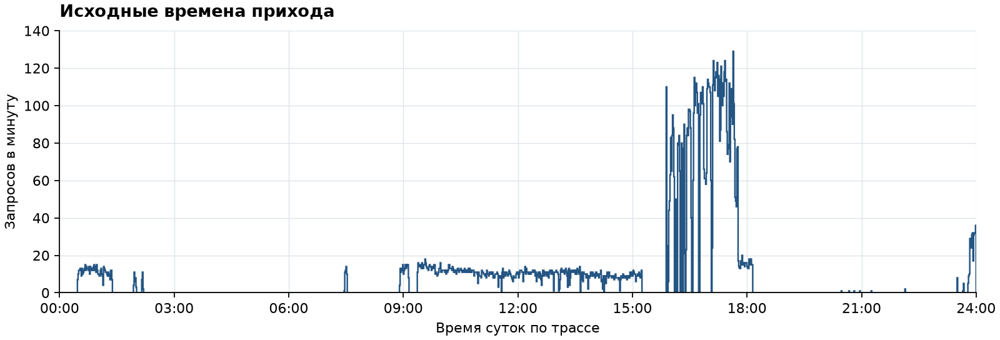
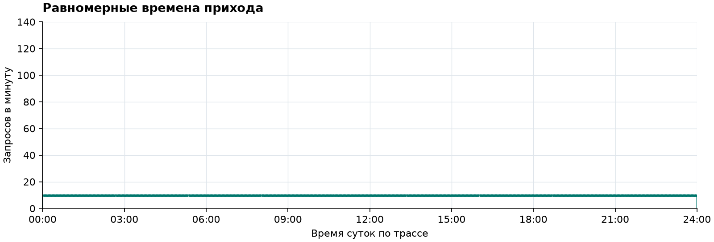
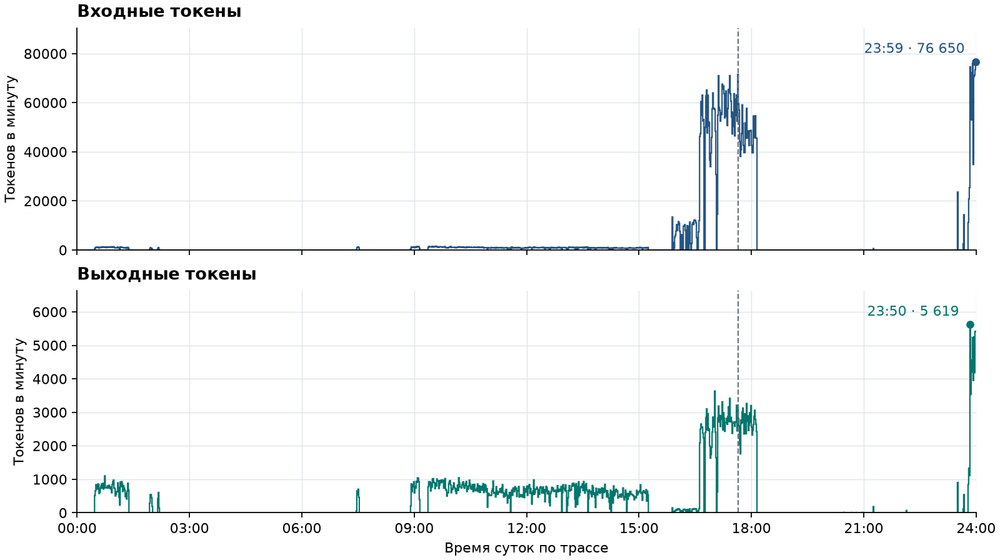

# Economics-analysis

## Этап 1. Сравнение профилей поступления запросов

Из `data/BurstGPT_1.csv` выбраны сутки с индексом 16 при нумерации с нуля. В исходной трассе `Timestamp` задан в секундах от полуночи первого дня, поэтому границы отбора составляют `[1 382 400, 1 468 800)`. В выборку вошли строки с `Model = ChatGPT`, `Log Type = API log` и `Response tokens > 0`. [BurstGPT, исходный CSV на зафиксированном коммите](https://github.com/HPMLL/BurstGPT/blob/d895a53bb7b8ec137d0d2fe203b335835a78c10a/data/BurstGPT_1.csv) · [Описание трассы](https://github.com/HPMLL/BurstGPT/tree/d895a53bb7b8ec137d0d2fe203b335835a78c10a#schema) · [CC BY 4.0](https://creativecommons.org/licenses/by/4.0/) · [Wang et al., KDD 2025](https://doi.org/10.1145/3711896.3737413)

- [Исходные времена прихода](stage1/day16_real.csv) сохранены с исходными значениями `Timestamp`.
- [Равномерные времена прихода](stage1/day16_uniform.csv) рассчитаны по формуле `1 382 400 + i × 86 400 / N`, где `i` — индекс запроса с нуля, а `N` — число запросов. Первый запрос приходится на `00:00:00`, шаг составляет около 6,20556 с. В CSV время записано с девятью знаками после точки. Порядок строк и все остальные поля совпадают построчно.

## Показатели

| Показатель | Исходный | Равномерный |
| --- | ---: | ---: |
| Запросов за сутки | 13 923 | 13 923 |
| Входных токенов | 6 154 754 | 6 154 754 |
| Выходных токенов | 577 752 | 577 752 |
| Среднее число запросов в минуту | 9,66875 | 9,66875 |
| Максимум запросов в минуту | 129 | 10 |

Реальный пик пришёлся на минуту `[17:38, 17:39)` по локальному времени трассы. Средние рассчитаны по всем 1 440 минутам суток, включая минуты без запросов. У графиков одинаковые шкалы по обеим осям.





После выравнивания минутный максимум снизился со 129 до 10 запросов. В исходном профиле 863 минуты прошли без запросов, а в равномерном на каждую минуту пришлось по 9 или 10 запросов при том же среднем за сутки.

## Минутные пики токенов в исходном потоке

В [поминутном CSV](stage1/day16_real_per_minute.csv) для каждой из 1 440 минут приведены число запросов и суммы входных и выходных токенов. Оба типа токенов суммируются по минуте прихода запроса, поэтому столбец выходных токенов показывает объём ответов на запросы, поступившие в эту минуту. `minute_start` обозначает начало минуты по локальному времени трассы. Для минут без запросов все три значения равны нулю. Суммы по минутам совпадают с суточными итогами в таблице выше.

| Показатель | Время пика | Максимум за минуту | Значение в 17:38 |
| --- | --- | ---: | ---: |
| Запросы | 17:38 | 129 | 129 |
| Входные токены | 23:59 | 76 650 | 71 500 |
| Выходные токены | 23:50 | 5 619 | 3 155 |

Пик входных токенов наступил через 6 ч 21 мин после пика числа запросов, а пик выходных токенов — через 6 ч 12 мин. В эти минуты пришло 36 и 29 запросов соответственно.



У двух панелей общая ось времени и отдельные шкалы по вертикали. Пунктир показывает пик числа запросов в 17:38, а точки отмечают максимумы по токенам.

## Воспроизведение

Скачайте исходный CSV по ссылке выше. Его SHA-256 — `46fc9480ef0b748ecb2b51d512ff08c196b031782cbe6f78e28044d768e86d5a`. Из корня репозитория выполните команды, указав путь к скачанному файлу.

```sh
python -m pip install "matplotlib>=3.6"
python stage1/prepare_traces.py /path/to/BurstGPT_1.csv
```

[Скрипт](stage1/prepare_traces.py) сохраняет оба потока, сверяет записи и суммы токенов, строит графики и формирует поминутный CSV исходного потока. По умолчанию файлы сохраняются в `stage1/`.
