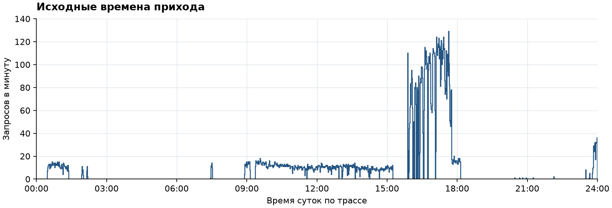
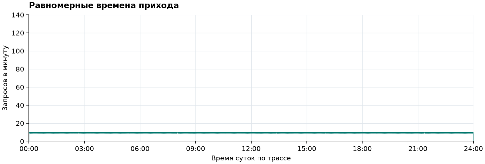
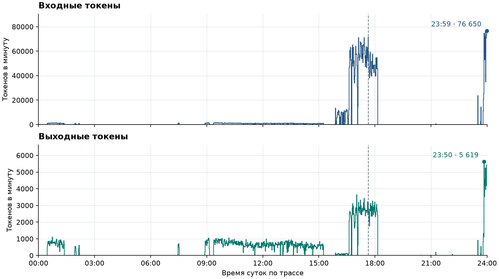

# Сутки 16. Профили поступления запросов и минутные пики

Из `data/BurstGPT_1.csv` выбраны сутки с индексом 16 при нумерации с нуля. В исходной трассе `Timestamp` задан в секундах от полуночи первого дня, поэтому границы отбора составляют `[1 382 400, 1 468 800)`. В выборку вошли строки с `Model = ChatGPT`, `Log Type = API log` и `Response tokens > 0`. [BurstGPT, исходный CSV на зафиксированном коммите](https://github.com/HPMLL/BurstGPT/blob/d895a53bb7b8ec137d0d2fe203b335835a78c10a/data/BurstGPT_1.csv) · [Описание трассы](https://github.com/HPMLL/BurstGPT/tree/d895a53bb7b8ec137d0d2fe203b335835a78c10a#schema) · [CC BY 4.0](https://creativecommons.org/licenses/by/4.0/) · [Wang et al., KDD 2025](https://doi.org/10.1145/3711896.3737413)

- [Исходные времена прихода](../day16_real.csv) сохранены с исходными значениями `Timestamp`.
- [Равномерные времена прихода](../day16_uniform.csv) рассчитаны по формуле `1 382 400 + i × 86 400 / N`, где `i` — индекс запроса с нуля, а `N` — число запросов. Первый запрос приходится на `00:00:00`, шаг составляет около 6,20556 с. В CSV время записано с девятью знаками после точки. Порядок строк и все остальные поля совпадают построчно.

## Показатели

| Показатель | Исходный | Равномерный |
| --- | ---: | ---: |
| Запросов за сутки | 13 923 | 13 923 |
| Входных токенов | 6 154 754 | 6 154 754 |
| Выходных токенов | 577 752 | 577 752 |
| Среднее число запросов в минуту | 9,66875 | 9,66875 |
| Максимум запросов в минуту | 129 | 10 |

Реальный пик пришёлся на минуту `[17:38, 17:39)` по локальному времени трассы. Средние рассчитаны по всем 1 440 минутам суток, включая минуты без запросов. У графиков одинаковые шкалы по обеим осям.

После выравнивания минутный максимум снизился со 129 до 10 запросов. В исходном профиле 863 минуты прошли без запросов, а в равномерном на каждую минуту пришлось по 9 или 10 запросов при том же среднем за сутки.

## Минутные пики токенов в исходном потоке

В [поминутном CSV](../day16_real_per_minute.csv) для каждой из 1 440 минут приведены число запросов и суммы входных и выходных токенов. Оба типа токенов суммируются по минуте прихода запроса, поэтому столбец выходных токенов показывает объём ответов на запросы, поступившие в эту минуту. `minute_start` обозначает начало минуты по локальному времени трассы. Для минут без запросов все три значения равны нулю. Суммы по минутам совпадают с суточными итогами в таблице выше.

Статистика пересчитана по отдельным запросам из `BurstGPT_1.csv` с теми же фильтрами и исходными временами прихода. Время в таблице обозначает начало минуты по трассе. Средние округлены до двух знаков.

| Начало минуты | Что достигло пика | Запросы | Вход, сумма | Вход, среднее | Вход, медиана | Вход, максимум | Выход, сумма | Выход, среднее | Выход, медиана | Выход, максимум |
| --- | --- | ---: | ---: | ---: | ---: | ---: | ---: | ---: | ---: | ---: |
| 17:38:00 | Число запросов | 129 | 71 500 | 554,26 | 131 | 3 059 | 3 155 | 24,46 | 1 | 235 |
| 23:50:00 | Сумма выходных токенов | 29 | 74 605 | 2 572,59 | 2 280 | 3 571 | 5 619 | 193,76 | 116 | 1 796 |
| 23:59:00 | Сумма входных токенов | 36 | 76 650 | 2 129,17 | 2 242,5 | 2 582 | 5 419 | 150,53 | 119,5 | 440 |

Среднее, медиана и максимум в таблице даны в токенах на запрос. Сумма входных токенов для `1 468 740 ≤ Timestamp < 1 468 800` составила ровно **76 650**.

В поздние минуты запросов было меньше, но входы и ответы обычно были длиннее. Медиана входа выросла со 131 токена в 17:38 до более чем 2 200 в обе поздние минуты, а медиана выхода — с 1 до 116 и 119,5. В 23:59 даже самый длинный вход был короче максимума в 17:38. В 23:50 один особенно длинный ответ дал 1 796 токенов, около 32% минутной суммы. Без него оставалось бы 3 823 выходных токена, что всё равно больше 3 155 в 17:38.

У двух панелей общая ось времени и отдельные шкалы по вертикали. Пунктир показывает пик числа запросов в 17:38, а точки отмечают максимумы по токенам.

[Сводка по суткам 16–22](../../README.md#сравнение-пиков-за-сутки-1622)
