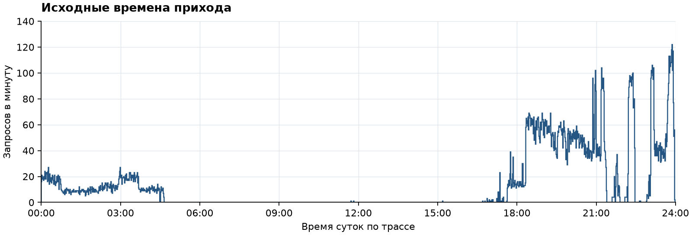
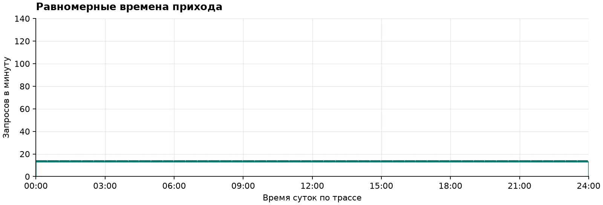
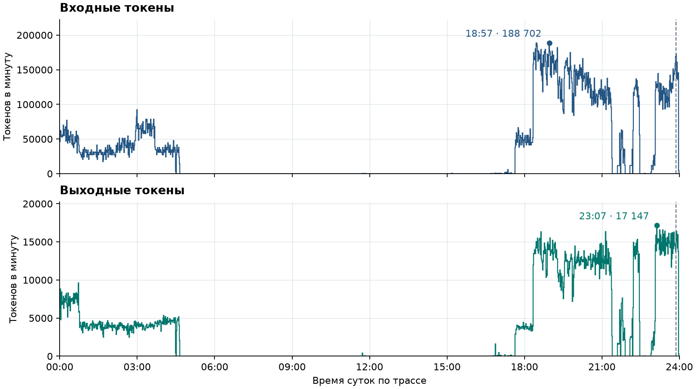

# Сутки 18. Минутные пики в исходном потоке

Сутки выделены из `BurstGPT_1.csv` с нумерацией от нуля. В выборку вошли `ChatGPT`, `API log` и строки с `Response tokens > 0`. Время в таблице обозначает начало минутного интервала по трассе. Входные и выходные токены отнесены к минуте прихода запроса.

| Начало минуты | Что достигло пика | Запросы | Вход, сумма | Вход, среднее | Вход, медиана | Вход, максимум | Выход, сумма | Выход, среднее | Выход, медиана | Выход, максимум |
| --- | --- | ---: | ---: | ---: | ---: | ---: | ---: | ---: | ---: | ---: |
| 18:57:00 | Сумма входных токенов | 69 | 188 702 | 2 734,81 | 2 251 | 3 501 | 14 432 | 209,16 | 180 | 682 |
| 23:07:00 | Сумма выходных токенов | 106 | 124 108 | 1 170,83 | 272 | 3 592 | 17 147 | 161,76 | 2 | 1 842 |
| 23:52:00 | Число запросов | 122 | 172 316 | 1 412,43 | 387,5 | 3 651 | 16 055 | 131,60 | 2 | 647 |

Среднее, медиана и максимум даны в токенах на запрос. Средние округлены до двух знаков.

Входной пик пришёлся на минуту с более длинными входами. Их медиана составила 2 251 токен против 387,5 в минуту пика числа запросов. В 23:07 медиана ответа осталась на уровне 2 токенов, а самый длинный ответ дал 1 842 токена. Без него минутная сумма составила бы 15 305, ниже 16 055 в 23:52.

## Графики

На первых двух графиках показано число запросов по минутам с одинаковыми шкалами. В равномерном варианте те же запросы распределены с шагом 24 часа / N по всем суткам.

На графике токенов пунктир отмечает пик числа запросов, а точки — пики по входным и выходным токенам.

[Сводка по суткам 16–22](../../README.md#сравнение-пиков-за-сутки-1622)
