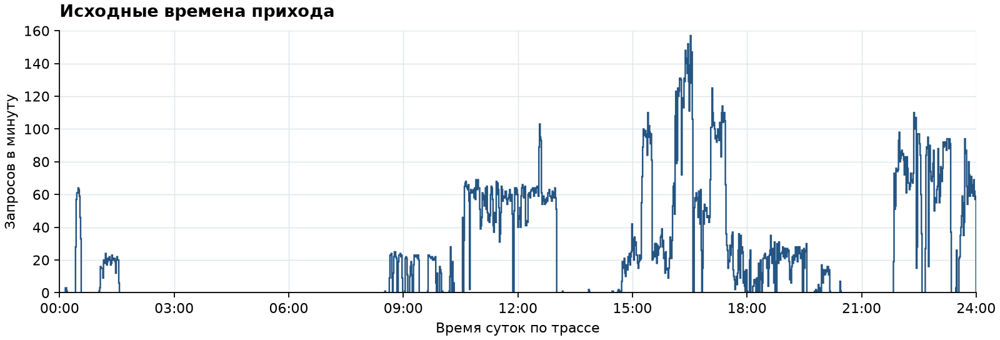
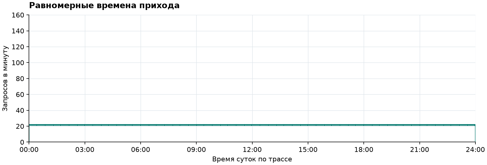
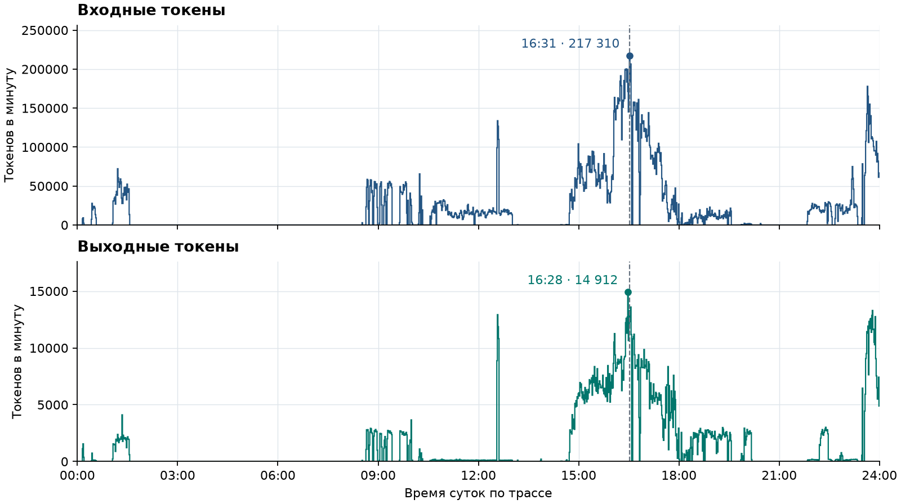

# Сутки 19. Минутные пики в исходном потоке

Сутки выделены из `BurstGPT_1.csv` с нумерацией от нуля. В выборку вошли `ChatGPT`, `API log` и строки с `Response tokens > 0`. Время в таблице обозначает начало минутного интервала по трассе. Входные и выходные токены отнесены к минуте прихода запроса.

| Начало минуты | Что достигло пика | Запросы | Вход, сумма | Вход, среднее | Вход, медиана | Вход, максимум | Выход, сумма | Выход, среднее | Выход, медиана | Выход, максимум |
| --- | --- | ---: | ---: | ---: | ---: | ---: | ---: | ---: | ---: | ---: |
| 16:28:00 | Сумма выходных токенов | 129 | 171 295 | 1 327,87 | 284 | 3 577 | 14 912 | 115,60 | 2 | 1 916 |
| 16:31:00 | Число запросов и сумма входных токенов | 157 | 217 310 | 1 384,14 | 321 | 3 465 | 13 268 | 84,51 | 2 | 703 |

Среднее, медиана и максимум даны в токенах на запрос. Средние округлены до двух знаков.

Пики числа запросов и входных токенов совпали в 16:31. Медиана ответа составила 2 токена в обеих пиковых минутах. В 16:28 самый длинный ответ дал 1 916 токенов. Без него сумма снизилась бы до 12 996 токенов против 13 268 в 16:31.

## Графики

На первых двух графиках показано число запросов по минутам с одинаковыми шкалами. В равномерном варианте те же запросы распределены с шагом 24 часа / N по всем суткам.

На графике токенов пунктир отмечает пик числа запросов, а точки — пики по входным и выходным токенам.

[Сводка по суткам 16–22](../../README.md#сравнение-пиков-за-сутки-1622)
