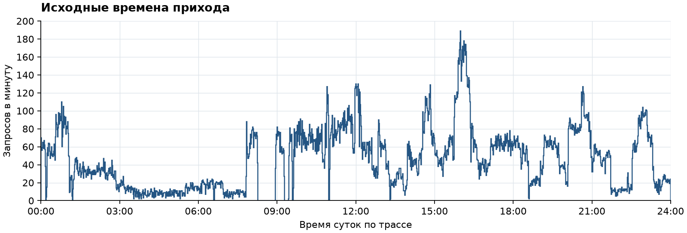
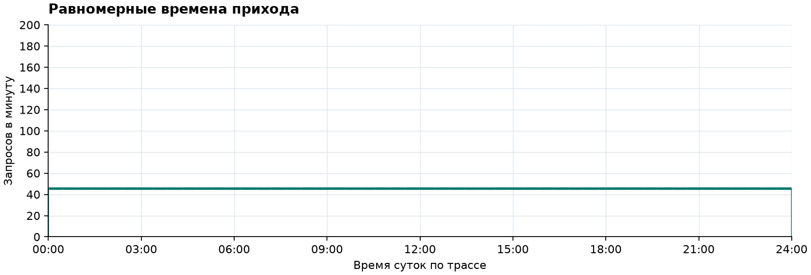
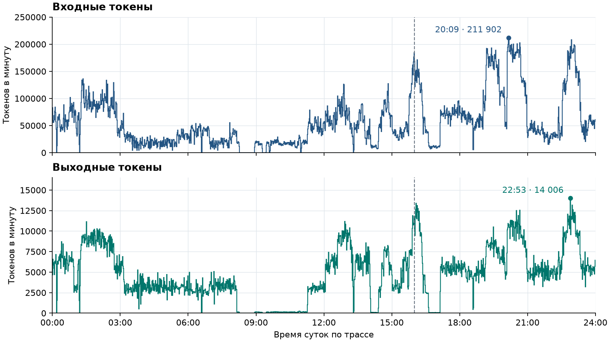

# Сутки 20. Минутные пики в исходном потоке

Сутки выделены из `BurstGPT_1.csv` с нумерацией от нуля. В выборку вошли `ChatGPT`, `API log` и строки с `Response tokens > 0`. Время в таблице обозначает начало минутного интервала по трассе. Входные и выходные токены отнесены к минуте прихода запроса.

| Начало минуты | Что достигло пика | Запросы | Вход, сумма | Вход, среднее | Вход, медиана | Вход, максимум | Выход, сумма | Выход, среднее | Выход, медиана | Выход, максимум |
| --- | --- | ---: | ---: | ---: | ---: | ---: | ---: | ---: | ---: | ---: |
| 15:59:00 | Число запросов | 189 | 184 347 | 975,38 | 794 | 3 318 | 11 790 | 62,38 | 60 | 326 |
| 20:09:00 | Сумма входных токенов | 92 | 211 902 | 2 303,28 | 2 441 | 3 329 | 10 617 | 115,40 | 94 | 565 |
| 22:53:00 | Сумма выходных токенов | 99 | 196 001 | 1 979,81 | 1 750 | 3 369 | 14 006 | 141,47 | 73 | 1 925 |

Среднее, медиана и максимум даны в токенах на запрос. Средние округлены до двух знаков.

В минуту входного пика медиана входа составила 2 441 токен против 794 в минуту пика числа запросов. В 22:53 медиана ответа выросла с 60 до 73 токенов. Даже без самого длинного ответа в эту минуту осталось бы 12 081 выходной токен против 11 790 в 15:59.

## Графики

На первых двух графиках показано число запросов по минутам с одинаковыми шкалами. В равномерном варианте те же запросы распределены с шагом 24 часа / N по всем суткам.

На графике токенов пунктир отмечает пик числа запросов, а точки — пики по входным и выходным токенам.

[Сводка по суткам 16–22](../../README.md#сравнение-пиков-за-сутки-1622)
