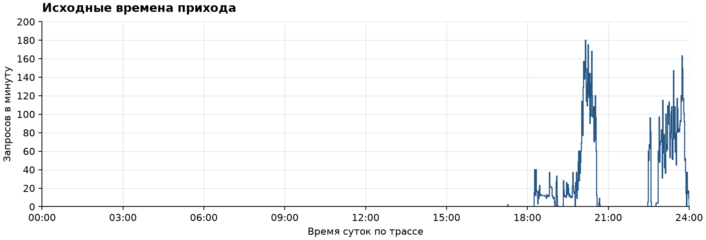
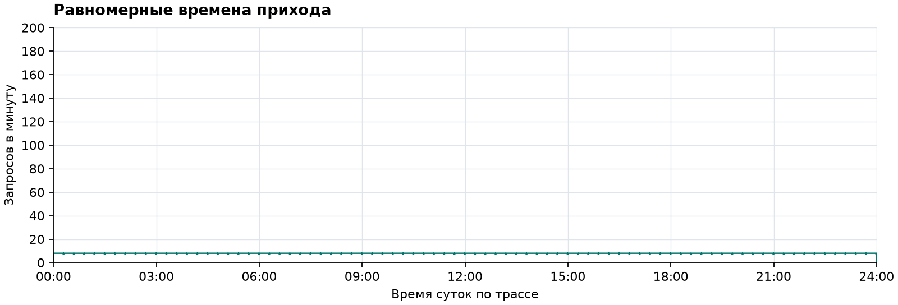
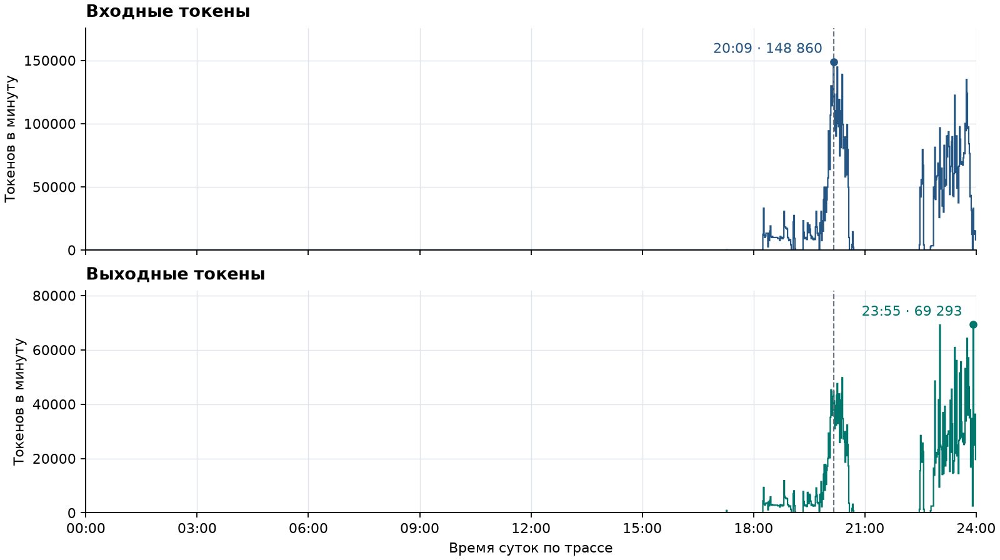

# Сутки 22. Минутные пики в исходном потоке

Сутки выделены из `BurstGPT_1.csv` с нумерацией от нуля. В выборку вошли `ChatGPT`, `API log` и строки с `Response tokens > 0`. Время в таблице обозначает начало минутного интервала по трассе. Входные и выходные токены отнесены к минуте прихода запроса.

| Начало минуты | Что достигло пика | Запросы | Вход, сумма | Вход, среднее | Вход, медиана | Вход, максимум | Выход, сумма | Выход, среднее | Выход, медиана | Выход, максимум |
| --- | --- | ---: | ---: | ---: | ---: | ---: | ---: | ---: | ---: | ---: |
| 20:09:00 | Число запросов и сумма входных токенов | 180 | 148 860 | 827,00 | 827 | 827 | 44 740 | 248,56 | 230 | 635 |
| 23:55:00 | Сумма выходных токенов | 37 | 32 967 | 891,00 | 891 | 891 | 69 293 | 1 872,78 | 1 811 | 2 804 |

Среднее, медиана и максимум даны в токенах на запрос. Средние округлены до двух знаков.

Пики числа запросов и входных токенов совпали в 20:09. В минуту выходного пика пришло 37 запросов против 180 в 20:09, а медиана ответа выросла с 230 до 1 811 токенов.

## Графики

На первых двух графиках показано число запросов по минутам с одинаковыми шкалами. В равномерном варианте те же запросы распределены с шагом 24 часа / N по всем суткам.

На графике токенов пунктир отмечает пик числа запросов, а точки — пики по входным и выходным токенам.

[Сводка по суткам 16–22](../../README.md#сравнение-пиков-за-сутки-1622)
